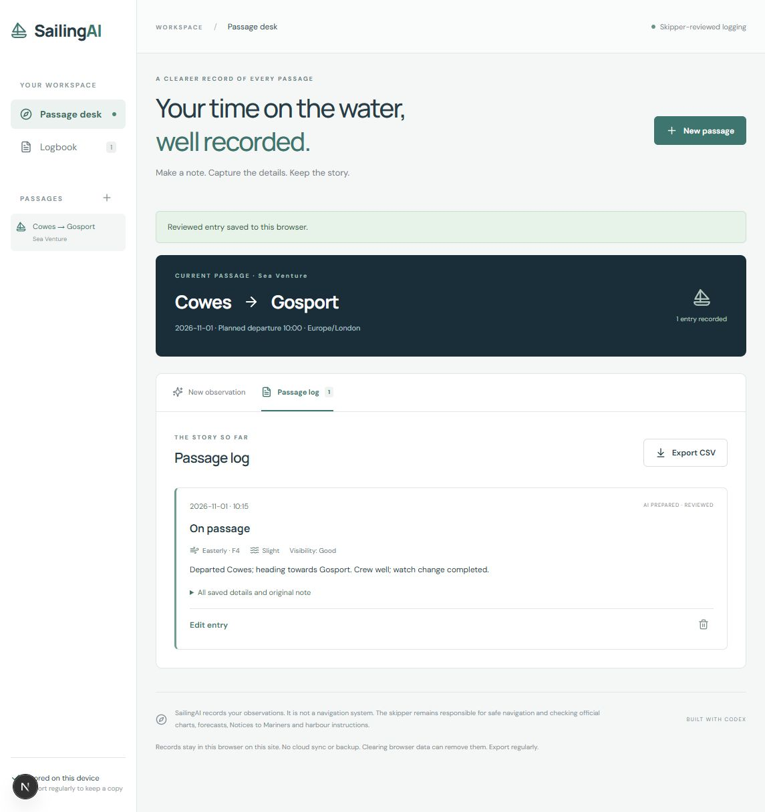

# SailingAI

Your intelligent sailing logbook. Built for recreational sailors who want to turn informal observations into consistent, reviewed passage records.

Create a passage → record an observation → prepare structured fields → review and correct → save → reopen → export CSV.



## Run locally

Requires Node.js 22.9+ and npm.

```sh
npm ci
cp .env.example .env.local
npm run dev
```

On PowerShell use `Copy-Item .env.example .env.local`. Open http://127.0.0.1:3000. Sample and manual modes need no API key. Choose **explore a sample passage**, create it, then **Review sample**. This is fixed sample data, not a live model response.

For live extraction, privately set `OPENAI_API_KEY`, `OPENAI_MODEL=gpt-6-luna` and `LIVE_AI_ENABLED=true` in `.env.local`, then restart the server. Do not paste keys into chat or commit them. This setting enables chargeable requests. Keep the server local unless production abuse controls have been configured.

```sh
npm run test
npm run lint
npm run typecheck
npm run build
npm start
```

Production checks and live-integration status are recorded in `docs/SUBMISSION.md`.

With a local server running and live calls explicitly enabled, `node scripts/verify-live.mjs` runs seven additional checks (five real AI extractions plus empty/overlength input rejection). This command incurs API usage and is deliberately separate from the offline unit suite.

## Implementation

Next.js App Router, React, TypeScript, CSS, Lucide icons, official OpenAI SDK, Responses API, Zod Structured Outputs and Vitest. A server route uses `responses.parse` with `zodTextFormat`; keys stay on the server. The model is instructed to extract only the submitted observation. Null readings stay unrecorded, and the original note and prepared draft are retained separately from reviewed values. Output validation checks types and ranges; the skipper checks meaning.

The endpoint has input/output bounds, no automatic retries and a 30-second SDK timeout. Live calls default to disabled. There is no shared production rate limiter: before anonymous public live AI, configure host-level abuse controls and usage monitoring or leave live AI disabled. Request and model errors preserve the note and allow manual entry. Model access has to be checked with the configured project.

## Records, privacy and limitations

Records use versioned localStorage in the current browser and origin. They do not sync or back up to a cloud account. Moving from localhost to a hosted site does not move your records. Clearing browser data can erase them. Failed reads protect existing storage; failed saves retain the open form. Export CSV regularly. CSV includes reviewed values, source, original notes and timestamps. Export-only apostrophes protect text cells that could be interpreted as formulas.

AI preparation sends the note to OpenAI. The app does not log request bodies, does not send passage/crew metadata unnecessarily and requests `store:false`; this is not a claim of zero retention by the API provider. Do not enter private or sensitive information unnecessarily.

No offline reopening guarantee, multi-device sync, GPS, charts or live weather. Time-only observations remain as written until the skipper confirms an observation date/time in Europe/London. Ambiguous DST times are rejected. Untimed entries are grouped after timed entries. Native modal keyboard focus trapping and broader accessibility auditing remain follow-up work.

## Safety

SailingAI records skipper observations and is not a navigation system. The skipper is responsible for navigation and verification against official charts, forecasts, Notices to Mariners and harbour instructions. User review does not certify an instrument reading. The sample Cowes–Gosport passage is illustrative; no route or live conditions are supplied.

## Deployment

The project is compatible with a Node-capable Next.js host such as Vercel. Import this repository, use `npm run build`, and configure environment variables on the host. Keep `LIVE_AI_ENABLED=false` until shared abuse controls are in place. Verify anonymous repository/video access and any app URL before submission. Deployment is optional under the event guide. No deployment URL is claimed yet.

## Built during the hackathon

The repository was empty at inspection on 1 November 2026. Application source, extraction endpoint, interface, storage/export utilities, tests and delivery documents were created during this session. See Git commits for the delivered changes.

## Existing work and credits

The SailingAI concept and discussion of an experimental Passage Desk predate this hackathon. No Passage Desk code or other pre-existing app source was imported. The supplied product brief was revised before implementation. Frameworks/libraries are credited above; icons are Lucide; fonts are DM Sans and Manrope via Google Fonts (system fallbacks apply without access). The sailing illustration is made with CSS and a Lucide sailing icon. No third-party nautical charts or marine data are used. No project licence is selected pending the owner's choice.

## How Codex helped

Codex implemented the observation schema and CSV export, then added checks proving that force 4 does not populate knots, invalid Beaufort values are rejected, reviewed notes appear in exports and potentially executable spreadsheet text is escaped. Test execution results are recorded in the submission notes. Codex also built the passage/review interface and server integration.

## Roadmap

Cloud backup, accounts, voice input, source-attributed marine forecasts/tides, GPS tracks, licensed charts, marina information and bookings. These require separate design and validation; navigation, payments and compliance engines are outside this release.

## Event delivery

See [demo instructions](docs/DEMO.md) and [submission status](docs/SUBMISSION.md). [Builders Guide](https://warp-peach-ef6.notion.site/) · [Event](https://luma.com/dde-ldn-hack).
