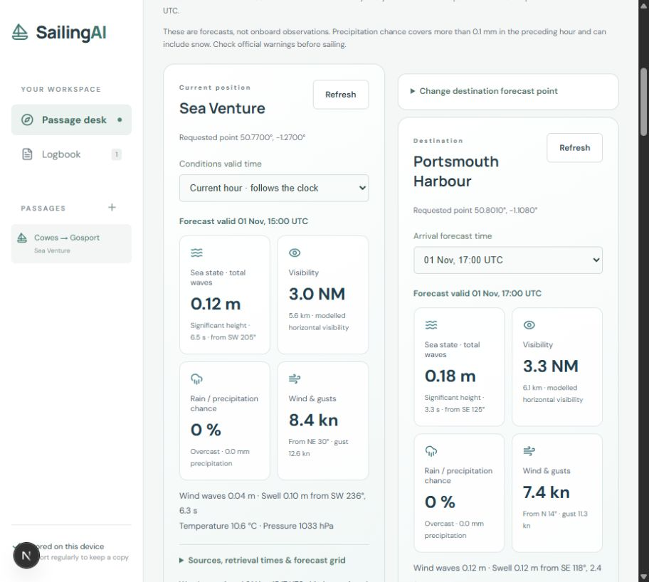
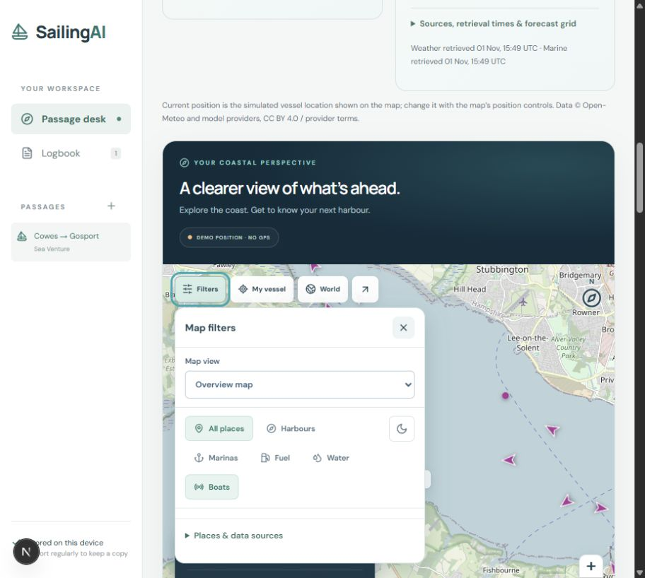
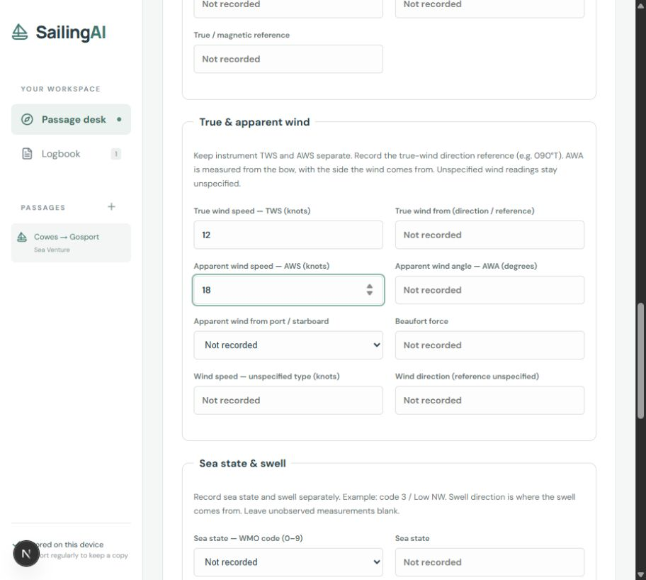
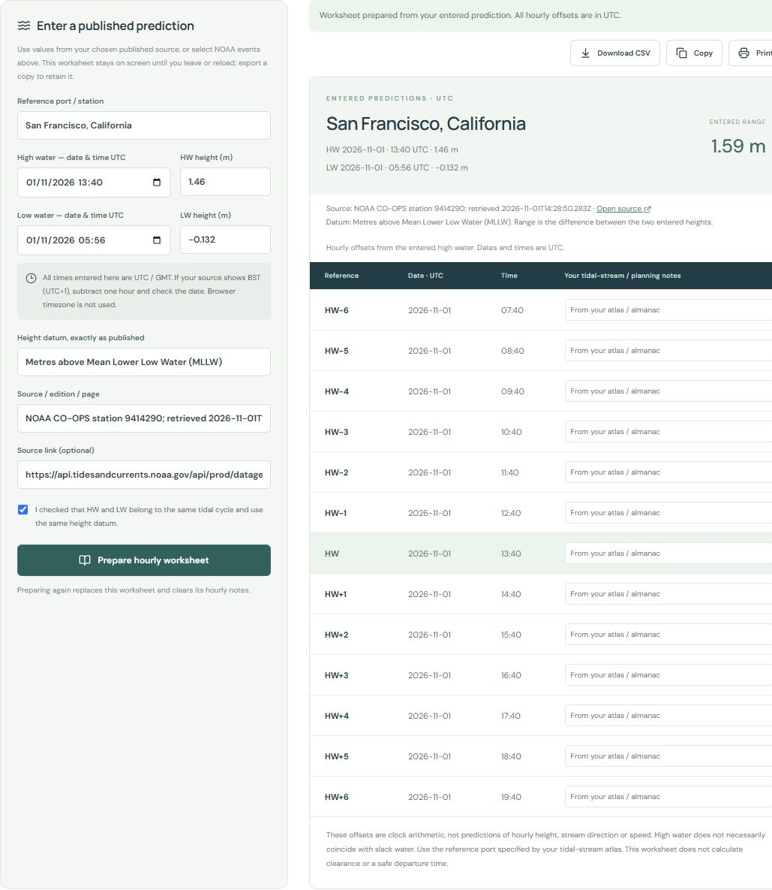

# SailingAI

**More clarity. Less admin. More time for the skipper.**

SailingAI brings passage forecasts, harbour information, vessel reports, planning notes and the logbook into one workspace. Its purpose is to help recreational skippers read useful information quickly, understand where it comes from, and keep a clear record of their passage.

Skippers often switch between weather pages, tide tables, marina directories and handwritten notes. SailingAI reduces that effort: compare current-position and destination conditions side by side, choose map views from one simple filter panel, and turn notes or paper-log photographs into structured drafts for review. The emphasis is **efficiency, clear presentation and easy access to information**, with units, timestamps and missing readings made visible. It supports the skipper’s judgement; it does not replace official navigation tools or a proper lookout.

Built during the DevDay Exchange Community Hackathon in London, 1 November 2026.

## Main features

### Skipper briefing: here now, there on arrival

- Separate forecast cards for current position and destination, with independent forecast times.
- Sea state, wind waves, swell height/direction/period, visibility, rain/precipitation chance, wind, gusts, temperature and pressure.
- Choose a destination harbour, coordinates or the final route checkpoint.
- Forecast-valid and retrieval times, hourly detail and source links. Automatic refresh every ten minutes while open; server responses may be cached for five minutes.
- Links to official Met Office marine forecasts and ADMIRALTY tide predictions.



*Forecasts are model predictions, separate from observed logbook readings. Screenshots show the demo on 1 November 2026, not current sailing conditions.*

### One map, one Filters panel

Open **Filters** on the map to choose an overview, UK/European seabed model or US chart reference view, and show boats, harbours, marinas, fuel or water. Day/night styling and expandable source details sit in the same panel. Changing views preserves the vessel and map position; there are no separate San Francisco or Solent chart buttons.

- **My vessel**, **World** and **Expand** remain immediately accessible.
- Select a harbour or marina for available facilities, VHF contacts, official guidance and directory links.
- Worldwide place discovery follows the viewed area when enabled. If community-data services fail, a bundled Natural Earth gazetteer provides 1,081 general port references. This is not every harbour or marina.
- **Boats** displays received AISstream reports and refreshes every five seconds. Requires an AISstream key. Limits: 5,000 recent vessels, up to 250 NM around the map centre, and reports expire after 30 minutes. Receiver coverage is incomplete.
- Vessel position is simulated for the demo; this release does not read onboard GPS.



### Editable passage routes

Add up to 50 named checkpoints by clicking the map. Drag markers, edit coordinates and names, reorder or delete checkpoints, and export GPX. Routes are saved in this browser. Distances are straight-line nautical miles and bearings are true; legs are not checked against land, shoals or restrictions.

### A fuller, reviewed logbook

Create a passage → record an observation → review the prepared fields → save → reopen → export CSV. Use manual entry, a fixed sample or optional AI extraction from your own notes.

Fields include time, position, instrument log distance, compass course, deviation, variation, leeway, true course/track, GPS COG, speed, depth/reference, pressure, visibility and weather notation. **True wind speed (TWS), apparent wind speed (AWS), apparent wind angle, sea-state code and swell** have separate fields. Missing measurements remain unrecorded; forecasts are not inserted as observations.

Routine entries support hourly logging; event entries preserve the actual minute. Review entries in the traditional table or full detail view, reopen saved passages, and export all recorded fields to CSV.



### Paper to digital

In **Passages & logbook**, open **Paper logbook · download template or upload a photo**:

1. Download the blank HTML template or open the print view and use **Print / Save as PDF**.
2. Complete the paper sheet and photograph it with readable writing and headings.
3. Upload JPEG, PNG or WebP, up to 6 MiB. Convert HEIC or PDF first.
4. With live AI configured, select **Read photo with AI**. Review each draft row, confirm its date/time and correct uncertain values before saving.

Imports support up to 12 draft rows. Selecting a photo alone does not send it to OpenAI. The app does not store the photo; unsaved drafts are lost on reload or leaving the passage workspace. Keep your original paper/image.

### Almanac & tides worksheet

Beside **Marinas**, **Almanac & tides** accepts published high/low-water times, heights, datum and source. It prepares a dated **HW−6 to HW+6** worksheet with editable notes, CSV download, copy and print.

Two named US NOAA stations support high/low-water imports. UK entries use published-source manual entry. The Reeds 2026 link opens the publisher’s paid digital edition; the book is not included. Worksheet times are UTC. The worksheet does not predict hourly heights, tidal-stream rates, slack water or safe clearance.



## Set up and run locally

### Requirements

- Node.js 22 (22.12 or later in that release line), or Node.js 24, and npm.
- Git to clone the repository, or download and extract the source ZIP.
- Internet for live forecasts, map tiles and external data. Sample/manual logging needs no API key.

### Install

```sh
git clone https://github.com/Gazzybear/SailingAI.git
cd SailingAI
npm ci
```

Create the private configuration file once. Preserve any existing `.env.local` containing your keys.

**Windows PowerShell:**

```powershell
if (!(Test-Path .env.local)) { Copy-Item .env.example .env.local }
```

**macOS / Linux:**

```sh
test -f .env.local || cp .env.example .env.local
```

Start the app:

```sh
npm run dev
```

Open **[http://127.0.0.1:3000](http://127.0.0.1:3000)** on the same computer. Keep the terminal running; press `Ctrl+C` to stop. The scripts bind locally, so this is not a public share link.

### Optional API configuration

Edit `.env.local` privately, then restart the server. Never put keys in browser-side variables, screenshots or Git commits. This file is ignored by Git.

| Feature | Configuration | Without a key |
| --- | --- | --- |
| AI notes and paper-photo reading | Set `OPENAI_API_KEY`, `OPENAI_MODEL` to a model available to your project, and `LIVE_AI_ENABLED=true`. The example uses `gpt-6-luna`. Photo reading needs image input support. | Manual entry and fixed sample remain usable. |
| Received boat positions | Set `AISSTREAM_API_KEY` from your AISstream account. | Live global boat reports are unavailable. |
| Local ADMIRALTY trial | After accepting provider terms, set `ADMIRALTY_API_KEY` and `ADMIRALTY_TRIAL_ENABLED=true`. | Trial charts are unavailable; other views remain usable. |
| Forecasts, overview map, EMODnet, NOAA and place discovery | No extra key for the current noncommercial demo integrations. | Internet access is still needed; outages and usage limits can apply. |

Live AI incurs API charges. Model access depends on your OpenAI project. Keep `LIVE_AI_ENABLED=false` for sample/manual use.

**ADMIRALTY status, verified 1 November 2026:** authentication succeeded, but Discovery returned blank chart images for tested south-coast areas and its documented example. The app detects these and reports unavailable coverage. A key does not currently guarantee a working trial chart. The local-only trial covers England’s south coast and is not up to date or routinely updated. See [integration details](docs/CHARTS-AND-AIS.md).

### First use

1. Create a passage or explore a sample passage.
2. Open **Skipper briefing** to compare conditions and choose destination/arrival time.
3. Open map **Filters**, select a view and enable places or boats. Select a pin for details.
4. Use **Add checkpoints** to sketch a route, or **Almanac & tides** for a published-prediction worksheet.
5. In **Passages & logbook**, enter observations manually, review a sample, or prepare an AI draft. Check every field before saving.
6. Export logbook CSV, route GPX and any almanac worksheet you want to keep.

### Checks and production-mode run

```sh
npm test
npm run lint
npm run typecheck
npm run build
npm start
```

Stop the development server before `npm start` to free port 3000. `npm start` serves the built app locally. The separate `node scripts/verify-live.mjs` requires the local server and live AI configuration; it makes chargeable API requests and is separate from offline unit tests.

## Data sources and practical limits

| Data | Source and scope |
| --- | --- |
| Weather, visibility and marine forecasts | Open-Meteo and model providers; grids may not resolve harbour conditions. Free endpoint use is noncommercial. |
| Overview map | OpenStreetMap contributors via Leaflet; not a nautical chart. |
| UK/European seabed | EMODnet DTM 2024, roughly 115 m grid. Click for cell means relative to LAT; not current depth or vessel clearance. |
| US chart display | NOAA reference display with soundings requested in metres; US only and not for navigation. |
| UK trial charts | ADMIRALTY Discovery; blank images in verification, limited south-coast coverage and noncurrent data. |
| Vessel traffic | AISstream received reports; incomplete and potentially delayed, not every vessel at sea. |
| Ports and marinas | Curated Solent guidance, community mapping via Overpass and Natural Earth fallback; official harbour/operator and Marinas.com links. |
| Tides | Published-source entry, selected NOAA events and official prediction links. Modelled sea level elsewhere is relative to mean sea level, not chart datum. |

SailingAI is **not a navigation or collision-avoidance system**. Use current official charts, forecasts, Notices to Mariners, tidal publications and harbour instructions. No map colour, route line, empty area or AI draft establishes that a passage is safe.

## Records and privacy

Passages, reviewed entries and routes are stored in this browser on this site. There are no accounts, cloud backups or multi-device sync. `localhost`, `127.0.0.1` and a hosted URL use different browser storage. Clearing site data can remove records. Export regularly; almanac worksheets and unsaved photo drafts need their own export before leaving/reloading.

AI preparation sends the submitted note or photo to OpenAI with `store:false`; this is not a claim of zero provider retention. Keys stay on the server. Map and forecast requests go to their respective providers. Offline reopening is not guaranteed. The interface uses labelled controls, keyboard-operable filters and readable units; a full accessibility audit remains outstanding.

## Hosting

The demo runs locally; no public deployment is claimed. Hosting needs a Node-capable environment, server-side secrets and abuse controls for chargeable AI. Continuous AIS uses an in-memory WebSocket collector and needs a suitable long-running server; stateless/serverless hosting needs a separate persistent collector. The ADMIRALTY trial proxy is local-only and must not be exposed as a public chart redistribution service.

## Built with Codex and credited sources

Next.js App Router, React, TypeScript, Leaflet, Lucide icons, the OpenAI SDK, Zod and Vitest. Fonts are DM Sans and Manrope via Google Fonts, with system fallbacks. Marine-data attribution appears in the app and linked documents. ADMIRALTY and UKHO are trademarks of the Secretary of State for Defence.

The idea and brief predate the event; no pre-existing Passage Desk code was imported. The core app was built during the hackathon. Codex helped implement reviewed extraction, storage/export, paper-photo import, map filters, route editing, forecast comparison and AIS collection. Tests cover keeping Beaufort force separate from knots, preserving missing readings, validating times and rejecting blank chart images. Git history records the changes. No project licence has yet been selected.

## Further documentation

- [Forecasts and live boats](docs/PASSAGE-CONDITIONS.md)
- [Logbook fields and photo workflow](docs/LOGBOOK-AND-PHOTOS.md)
- [Charts and AIS](docs/CHARTS-AND-AIS.md)
- [UK depth model](docs/UK-DEPTH.md)
- [Worldwide place discovery](docs/WORLDWIDE-DISCOVERY.md)
- [Data-source research](docs/DATA-SOURCES.md)
- [Demo instructions](docs/DEMO.md) and [submission notes](docs/SUBMISSION.md)

[Hackathon event](https://luma.com/dde-ldn-hack) · [Builders Guide](https://warp-peach-ef6.notion.site/)
